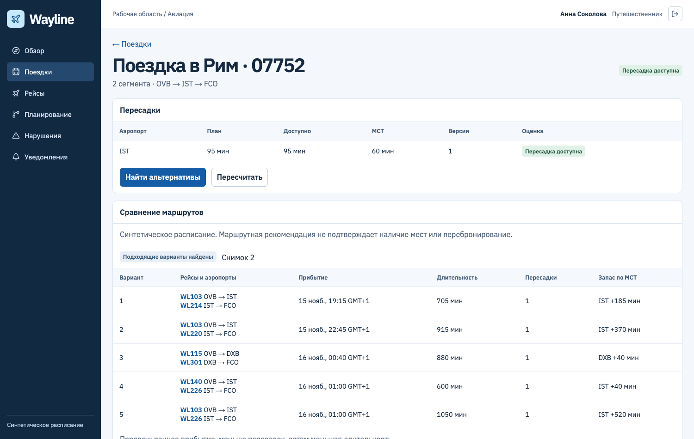

# Wayline · Trips and flights

[Русский](README.ru.md) · [English](README.en.md)

Wayline is an educational TravelTech platform. It links dated flight legs to saved itineraries, explains the impact of delays and suggests feasible alternatives from a synthetic timetable. Operations analysts can trace why each provider revision was applied, retained as stale or rejected.

## Run locally

```sh
docker compose up --build --wait
```

Open [Wayline](http://127.0.0.1:8140). Compose applies migrations and retrieves the synthetic catalogue from the provider. The local demo password is `Wayline-local-demo`. See `.env.example` for the port and initial password.

| Login | Scope |
| --- | --- |
| `traveler` | Owned trips, assessments, alerts and alternatives |
| `other` | Separate traveler for scope verification |
| `analyst` | Provider monitoring, sync, event exploration and diagnostics |
| `admin` | Demo user creation, MCT publication and Lab scenarios |

## How it works

- React and TypeScript call FastAPI through nginx. A worker polls an independent HTTP provider. Wayline stores its state in PostgreSQL. The provider owns a separate SQLite volume.
- The delivery cursor and flight revision serve separate purposes. The projection, trip assessments, notifications and cursor commit together. A failure keeps the previous data and records provider unavailability.
- Scheduled, estimated and actual times are separate. Elapsed-time arithmetic uses absolute instants. The browser displays dates in each airport's IANA zone.
- Versioned synthetic MCT depends on airport, international context and terminal change. The temporal search enforces MCT, horizon and leg limits and excludes unusable flights. Options rank by arrival, connections and duration.
- Travelers can acknowledge an incident. Recovery resolves the active incident while keeping history and messages.

[Requirements and decisions](docs/design.md) · [Data model](docs/diagrams/data.mmd) · [REST OpenAPI](docs/openapi.json) · [Provider contract](docs/provider-openapi.json) · [Swagger UI](http://127.0.0.1:8140/api/docs)

## Lab and testing

```sh
scripts/lab up
```

Open [Wayline Lab](http://127.0.0.1:8141) as `admin`. Lab includes HTTP evidence, before and after snapshots and check results. `scripts/lab reset` recreates the lab volumes. [Commands and traceability](docs/verification.md) · [GitHub Actions](https://github.com/bivaettttt/wayline/actions)

## Repository and limitations

`backend/` contains FastAPI modules, Alembic migrations and the worker. `provider/` contains the independent simulator. `frontend/` contains the UI and Playwright. Verification, launch commands and documentation live in `tests/`, `scripts/` and `docs/`.

The server enforces ownership. Compose binds the workspace to loopback. Credentials and session tokens are stored as hashes. Suggested routes use a synthetic catalogue and confer no ticket, inventory, baggage or visa confirmation. [Status and limitations](docs/PROJECT_STATUS.md)

The project source currently has no separate license. Third-party libraries retain their licenses.

## Demonstration



[Walkthrough, captures and video](docs/demo.md) · [Portfolio case study](docs/portfolio.md)
