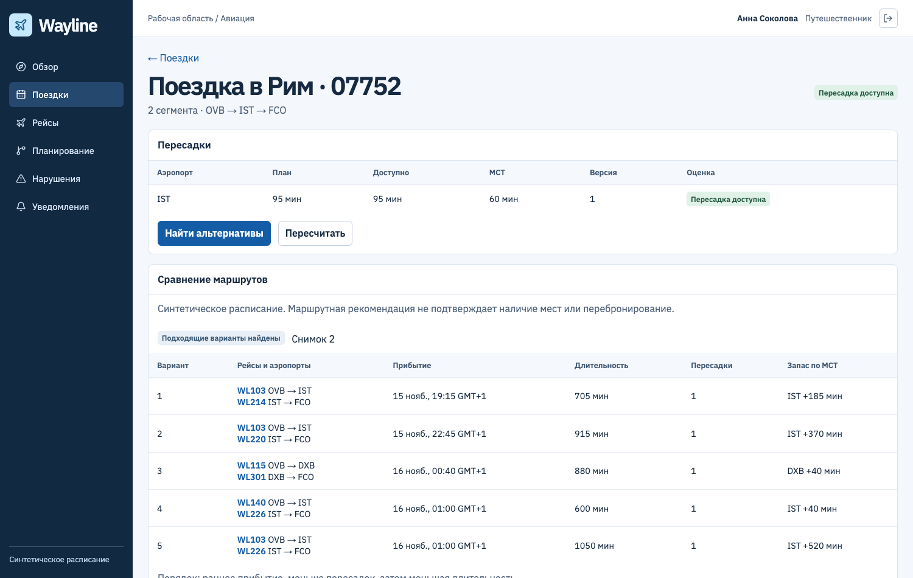

# Wayline

Wayline monitors synthetic flight itineraries, explains connection risk and compares feasible alternatives. An independent provider publishes flight events over HTTP.

Wayline отслеживает учебные рейсы, объясняет риск пересадки и сравнивает допустимые альтернативы.

[Русский](README.ru.md) · [English](README.en.md) · [OpenAPI](docs/openapi.json) · [Provider API](docs/provider-openapi.json)

```sh
docker compose up --build --wait
```

[Рабочая область / Workspace](http://127.0.0.1:8140)



[Сценарий, скриншоты и видео / Walkthrough, captures and video](docs/demo.md)
