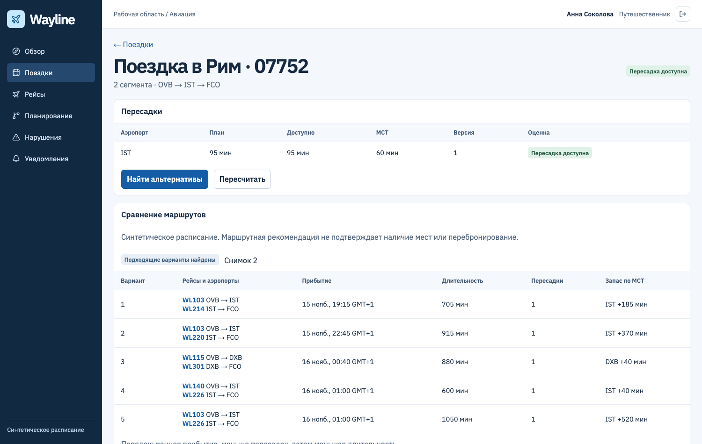

# Wayline · Поездки и рейсы

[Русский](README.ru.md) · [English](README.en.md)

Wayline — учебная TravelTech-платформа. Она связывает рейсы с датированными маршрутами, объясняет влияние задержки и предлагает допустимые варианты на синтетическом расписании. Операционный аналитик может проследить, почему версия поставщика была принята, признана устаревшей или отклонена.

## Запуск

```sh
docker compose up --build --wait
```

Откройте [Wayline](http://127.0.0.1:8140). Compose создаёт БД, применяет миграции и получает учебное расписание от провайдера. Локальный пароль учебных аккаунтов — `Wayline-local-demo`. `.env.example` содержит параметры порта и начального пароля.

| Логин | Доступ |
| --- | --- |
| `traveler` | Собственные поездки, оценки, уведомления и альтернативы |
| `other` | Отдельный путешественник для проверки доступа |
| `analyst` | Мониторинг провайдера, синхронизация, события и диагностика |
| `admin` | Учебные пользователи, версии MCT и сценарии Lab |

## Как работает

- React и TypeScript через nginx обращаются к FastAPI. Worker регулярно запрашивает события отдельного HTTP-провайдера. Состояние Wayline хранится в PostgreSQL, лента провайдера — в собственном SQLite-томе.
- Курсор доставки и версия рейса учитываются раздельно. Проекция, оценки связанных поездок, уведомления и курсор обновляются одной транзакцией. При сбое данные сохраняются, а источник помечается недоступным.
- План, прогноз и факт хранятся раздельно. Интервалы вычисляются по абсолютному времени. Интерфейс переводит даты в IANA-зоны аэропортов.
- Версия учебного MCT зависит от аэропорта, международного контекста и смены терминала. Поиск по временному графу применяет MCT, горизонт и максимум сегментов, исключает отменённые и непригодные рейсы. Варианты ранжируются по прибытию, числу пересадок и длительности.
- Нарушение можно принять к сведению. Восстановление закрывает активный инцидент и сохраняет историю вместе с уведомлениями.

[Требования и решения](docs/design.md) · [Данные](docs/diagrams/data.mmd) · [REST OpenAPI](docs/openapi.json) · [Контракт провайдера](docs/provider-openapi.json) · [Swagger UI](http://127.0.0.1:8140/api/docs)

## Лаборатория и проверка

```sh
scripts/lab up
```

Откройте [Wayline Lab](http://127.0.0.1:8141) под `admin`. Lab показывает фактические HTTP-ответы, состояние до и после и результаты проверок. `scripts/lab reset` пересоздаёт только тома лаборатории. [Команды, тесты и трассируемость](docs/verification.md) · [GitHub Actions](https://github.com/bivaettttt/wayline/actions)

## Репозиторий и ограничения

`backend/` содержит модули FastAPI, миграции Alembic и worker. `provider/` содержит независимый симулятор. `frontend/` содержит интерфейс и Playwright. `tests/`, `scripts/` и `docs/` содержат проверки, команды запуска и документацию.

Доступ к поездкам проверяется на сервере. Настройки Compose публикуют интерфейс только на loopback. Пароли и сессии хранятся в виде хешей. Альтернативы применимы к учебному каталогу и не подтверждают бронирование, наличие мест, визовые или багажные условия. [Статус и ограничения](docs/PROJECT_STATUS.md)

Для исходников проекта отдельная лицензия пока не назначена. Сторонние библиотеки сохраняют свои лицензии.

## Демонстрация



[Сценарий, скриншоты и видео](docs/demo.md) · [Материал для портфолио](docs/portfolio.md)
